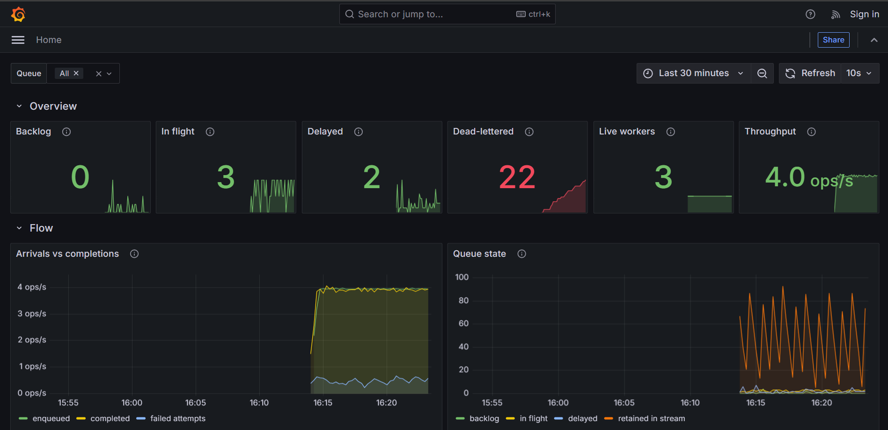
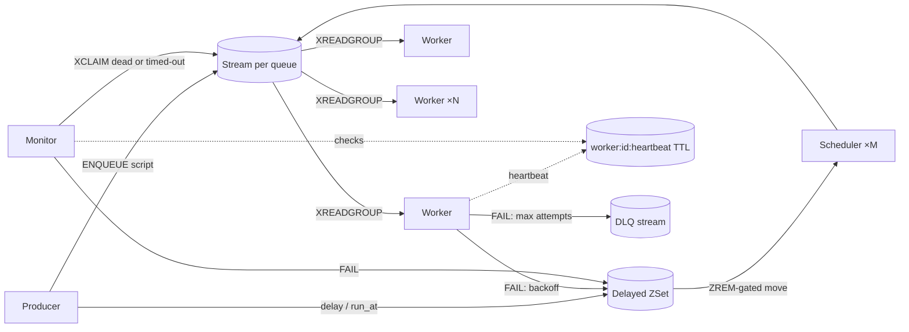
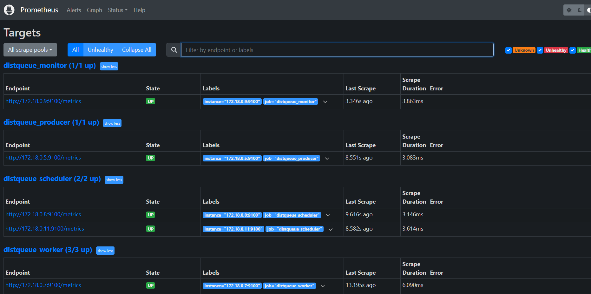

# distqueue

[](https://github.com/SID-singh1/Distqueue/actions/workflows/ci.yml)


**A distributed job queue and task scheduler built from scratch on Redis
primitives (Streams, consumer groups, sorted sets, Lua), with heartbeat-based
failure detection, fencing against stalled workers, and full Prometheus and
Grafana observability.**

No Celery, no Kafka, no queue library. Every guarantee is implemented and
tested here, including what happens when a worker is killed, frozen, or
times out mid-job.



## Highlights

| | |
|---|---|
| **Scales out linearly** | 44 → 342 jobs/s from 1 → 8 workers on 20 ms jobs (97% efficiency); 1–3 ms of queue overhead per job ([benchmarks](docs/benchmarks.md)) |
| **Survives worker crashes** | A SIGKILLed worker's job is detected in 19 s, retried on another worker, and charged exactly one attempt. Verified by a chaos test in CI |
| **Fenced against zombies** | A worker frozen past its heartbeat TTL wakes up and tries to report its job; the stale write is **rejected**. Also verified in CI |
| **Atomic state machine** | Every job state change is one Lua script; worker writes are checked against Redis's own lease table (the PEL) |
| **Operable** | `distqueue` CLI for stats, job inspection and DLQ replay; 20 metrics; 7 alert rules; a provisioned dashboard |
| **Tested** | 157 tests (unit and real-Redis integration: concurrency, fencing, end-to-end), 92% coverage, on Python 3.11 and 3.13 |

## Guarantees

| Property | Guarantee |
|---|---|
| Delivery | **At-least-once.** Jobs are acknowledged only after the handler finishes; un-acked jobs are reclaimed |
| Job state | **Consistent per job.** A worker that lost its job (crash, pause, timeout) can't overwrite it |
| Enqueue | **Exactly-once with an idempotency key** |
| Retries | Bounded by `max_attempts`; crashes and timeouts count as attempts, so poison jobs can't loop forever |
| Ordering | FIFO delivery per queue; completion order isn't guaranteed |

Execution is *at-least-once*, not exactly-once: if a worker stalls and its
job is re-run elsewhere, both runs may have performed side effects. Handlers
must be idempotent, which is the same contract SQS, Sidekiq and Celery
(`acks_late`) offer. See [design.md §1](docs/design.md#1-guarantees-stated-precisely).

## Architecture



| Component | Role |
|---|---|
| **Producer** | `enqueue()` writes the job hash and a pointer onto the queue's stream in one Lua script, with an optional delay or idempotency key |
| **Worker** | Reads with a consumer group, runs your handler, reports COMPLETE or FAIL. A heartbeat thread proves it's alive; it stops taking work if the heartbeat is failing |
| **Scheduler** | Moves due retries and scheduled jobs back onto their queue. Runs as several replicas with no leader election, because the move is gated on `ZREM` and can't double-inject |
| **Monitor** | Reclaims jobs from dead workers and from jobs past their timeout (`XCLAIM` on the exact entry), trims streams, garbage-collects dead consumers, and publishes queue gauges |

Each job lives in one hash, `job:{id}`. The stream entry is only a pointer,
so there is a single source of truth. The full data model, state machine and
reasoning are in **[docs/design.md](docs/design.md)**.

## Quickstart

Requirements: Docker Desktop (or Docker Engine with Compose v2).

```bash
git clone https://github.com/SID-singh1/Distqueue.git && cd Distqueue
docker compose -f docker/docker-compose.yml --profile demo up --build -d
```

This starts Redis (with AOF persistence), 3 workers, 2 schedulers, a monitor,
a demo producer (4 jobs/s, with some deliberate failures), Prometheus and
Grafana.

| | |
|---|---|
| Grafana dashboard | http://localhost:3000 (anonymous view; admin/admin to edit) |
| Prometheus targets and alerts | http://localhost:9090/targets, http://localhost:9090/alerts |

Then try the CLI, which is in every container:

```bash
docker compose -f docker/docker-compose.yml exec monitor distqueue stats
docker compose -f docker/docker-compose.yml exec monitor distqueue enqueue '{"sleep_s": 3}' --delay 10
docker compose -f docker/docker-compose.yml exec monitor distqueue dlq list
docker compose -f docker/docker-compose.yml exec monitor distqueue dlq replay --all
```

Scale and break things, and watch the dashboard react:

```bash
docker compose -f docker/docker-compose.yml up -d --scale worker=1   # overload: backlog and queue wait climb
docker compose -f docker/docker-compose.yml up -d --scale worker=6   # drains; Prometheus discovers the new workers
docker kill distqueue-worker-2                                       # job reclaimed within ~20 s
```

## Use it as a library

```python
from distqueue import PermanentError, Worker, enqueue, get_redis_client

client = get_redis_client()  # REDIS_URL or REDIS_HOST/PORT/DB

job_id = enqueue(
    client,
    {"to": "ada@example.com", "template": "welcome"},
    queue="emails",
    max_attempts=5,
    timeout_s=30,  # reclaimed if it runs longer
    delay_s=60,  # or run_at=<epoch>
    idempotency_key="signup-4711",  # a retried enqueue won't duplicate it
)


def send_email(payload: dict) -> None:
    if "@" not in payload["to"]:
        raise PermanentError("invalid address")  # straight to the DLQ, no retries
    ...  # any other exception = retry with backoff


Worker(client, send_email, queue="emails").run()
```

Or point the worker CLI at any importable function:
`distqueue worker --queue emails --handler myapp.jobs:send_email`. Run at
least one `distqueue scheduler` (for retries and delays) and one
`distqueue monitor` (for crash recovery) alongside your workers.

## Observability

**Metrics** (all prefixed `distqueue_`):

| Group | Metrics |
|---|---|
| Flow | `jobs_enqueued_total`, `jobs_completed_total`, `jobs_failed_total{outcome, trigger}`, `jobs_deduplicated_total` |
| Latency (histograms) | `job_queue_wait_seconds` (the SLI), `job_duration_seconds`, `job_end_to_end_seconds` |
| Queue state (gauges) | `queue_backlog` (consumer-group lag), `pending_entries`, `delayed_jobs`, `dlq_depth`, `live_workers`, `stream_length` |
| Recovery | `jobs_reclaimed_total{reason}`, `lease_lost_total` (fenced writes), `redis_errors_total`, `heartbeat_failures_total` |

**Alerts** ([docker/alerts.yml](docker/alerts.yml)): p95 queue wait over
30 s, backlog growing, no live workers, jobs dead-lettered, sustained
rejected stale writes, Redis errors, component down.

Cross-process durations (queue wait, end-to-end, retry due times) are all
measured on **Redis's clock**, so clock skew between hosts can't distort
them.



## Testing

```bash
pip install -e ".[dev,chaos]"
docker compose -f docker/docker-compose.yml up -d redis       # integration tests use DB 15
pytest                                                        # 157 tests
```

| Layer | What it proves |
|---|---|
| Unit (69) | Backoff maths (jitter survives the cap), job serialisation and backward compatibility, config, CLI, metrics exposition |
| Integration (88, real Redis) | Every transition and its fencing; cold start; duplicate and corrupt deliveries; heartbeat resilience; NOGROUP recovery; monitors and schedulers racing; trimming; end-to-end retries; 4 workers × 400 jobs with no duplicates |
| Chaos ([chaos/](chaos/)) | `kill_worker`: SIGKILL mid-job, then recovery. `pause_worker`: freeze past the TTL, then the stale write is rejected |
| Load ([loadtest/](loadtest/)) | Throughput against worker count, and end-to-end latency at 50% load |

CI ([.github/workflows/ci.yml](.github/workflows/ci.yml)) runs lint, the full
suite on Python 3.11 and 3.13 against a Redis service container, promtool
validation, an image build, and both chaos experiments against the real
Compose stack.

**Chaos results** (default settings: 15 s heartbeat TTL, 5 s monitor poll):

| Experiment | Detected | Retry running | Outcome |
|---|---|---|---|
| SIGKILL a worker mid-job | 19.0 s | 22.0 s | completed by another worker, 1 attempt charged |
| Freeze a worker past its TTL | 13.9 s | after the 2–4 s retry backoff | stale COMPLETED write **rejected**; completed once elsewhere |

## Benchmarks

8 vCPU laptop, Redis 7.4, workers as separate processes. Details and
methodology are in [docs/benchmarks.md](docs/benchmarks.md).

| Workers | 20 ms jobs: throughput | Scaling efficiency | e2e p50 / p99 |
|---:|---:|---:|---:|
| 1 | 44 jobs/s | 100% | 23.0 / 24.6 ms |
| 8 | 342 jobs/s | 97% | 21.3 / 22.1 ms |

With no-op jobs, a single Redis saturates at about **4.5k jobs/s**: three
round trips and two Lua scripts per job, on Redis's single command thread.
That's the scaling limit of this design. The next steps would be batch
delivery or sharding queues across Redis instances.

## Key design decisions

- **Lua scripts, not MULTI/EXEC.** Transitions need check-then-write (Is the
  idempotency key new? Do I still own this job?). MULTI/EXEC can't branch;
  a Lua script runs atomically with no other command in between.
- **The PEL as a lease table, used as a fencing token.** A paused worker
  can't know its lease expired, so storage has to refuse its writes
  (Kleppmann, *How to do distributed locking*).
- **`XCLAIM` on the exact entry, not `XAUTOCLAIM`.** XAUTOCLAIM claims the
  *next* idle entry if the requested one is gone, which can be a healthy
  worker's job.
- **Heartbeat plus timeout.** A heartbeat proves the process is alive; only a
  timeout catches a hung handler.
- **Equal-jitter backoff.** Jitter is applied after the cap and scales with
  the delay, so retries never synchronise.
- **Consumer-group lag for backlog, not `XLEN`.** XACK doesn't delete stream
  entries, so XLEN counts history, not work.
- **No client-side auto-retry.** Blindly re-sending a non-idempotent script
  after a lost reply duplicates its effect; retries live in layers that know
  whether an operation is safe to repeat.

## Configuration

Every tuning knob is an environment variable (`DISTQUEUE_<NAME>`); see
[distqueue/config.py](distqueue/config.py), where each one documents its
reasoning. Common ones:

| Variable | Default | |
|---|---|---|
| `REDIS_URL` or `REDIS_HOST`/`REDIS_PORT`/`REDIS_DB` | `localhost:6379/0` | connection |
| `DISTQUEUE_HEARTBEAT_INTERVAL_S` / `_TTL_S` | 5 / 15 | liveness |
| `DISTQUEUE_DEFAULT_MAX_ATTEMPTS` | 5 | retries before the DLQ |
| `DISTQUEUE_DEFAULT_JOB_TIMEOUT_S` | 300 | 0 disables |
| `DISTQUEUE_BASE_BACKOFF_S` / `_MAX_BACKOFF_S` | 2 / 300 | backoff curve |
| `DISTQUEUE_COMPLETED_JOB_TTL_S` / `DEAD_JOB_TTL_S` | 1 day / 7 days | retention |

## Project layout

```
distqueue/            library + CLI
  transitions.py      the state machine: every transition as one Lua script
  producer.py worker.py scheduler.py monitor.py
  backoff.py runloop.py stats.py metrics.py config.py cli.py
tests/unit/           fast, no Redis
tests/integration/    real Redis: fencing, concurrency, end-to-end
chaos/                kill_worker.py, pause_worker.py
loadtest/             benchmark.py
docker/               compose, Prometheus config and alerts, Grafana provisioning
docs/                 design.md, benchmarks.md
```

## Limitations

Redis is a single point of failure (production would add replicas plus
Sentinel). The scripts aren't Redis Cluster ready yet (they need hash tags).
Each worker process runs one job at a time. There are no priorities and no
recurring (cron) jobs. See [design.md §11](docs/design.md#11-known-limitations-and-next-steps).
